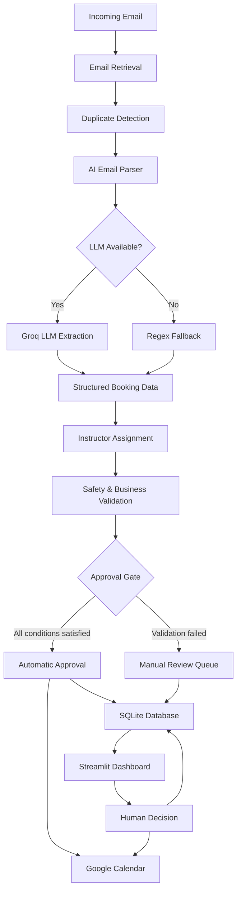

<div align="center">

# 🏄 AI Agent for Surf School

**AI-powered booking management and instructor scheduling for surf schools.**

Turns unstructured booking emails into validated, calendar-ready lessons, with a human in control of every edge case.


[Features](#-features) · [Architecture](#-architecture) · [Quick Start](#-quick-start) · [Configuration](#-configuration) · [Roadmap](#-roadmap)

</div>

---

## 📖 Overview

Surf schools often handle lesson requests by email: someone reads every message, checks instructor availability, and creates bookings by hand. This project automates that workflow.

The system monitors an inbox, uses an LLM to extract booking details, matches customers with qualified instructors, validates every request against business rules, and syncs approved lessons to Google Calendar. Anything uncertain goes to a human review queue.

**Core idea:** the LLM *understands* the email, and deterministic Python logic *makes the decisions*.

## ✨ Features

### 🤖 AI Email Understanding
- Structured extraction from free-form emails using Groq-hosted Llama models
- Intent detection: **new booking**, **cancellation**, **rescheduling**, **general question**
- Extracts customer name, lesson type, date, time, and group size
- Automatic **regex fallback** when the LLM is unavailable or returns invalid data

### 🧑‍🏫 Instructor Assignment
- Matches instructors by availability, qualifications, and skill level
- Honors customer-requested instructors
- Calculates remaining instructor capacity and checks existing bookings
- Routes requests with no suitable instructor to manual review

### 🛡️ Safety & Validation Layer
Every request passes through a dedicated validation engine before auto-approval:

| Check | Description |
|---|---|
| Date & time | Valid, parseable, in the future |
| Operating hours | Within configured business hours |
| Lead time | Minimum advance booking requirement |
| Booking horizon | Maximum days ahead for auto-approval |
| Duplicates | Duplicate booking detection via fingerprints |
| Limits | Per-customer booking limits and per-sender rate limits |
| Capacity | Instructor availability and remaining capacity |
| Eligibility | Allowed lesson types and group sizes for auto-approval |

### 📅 Google Calendar Integration
- Creates events for approved lessons with lesson, instructor, and customer details
- Configurable calendar ID
- Google Service Account authentication

### 👤 Human-in-the-Loop Dashboard
A Streamlit interface where administrators can:
- Browse incoming requests and inspect extracted data
- Review safety flags and validation results
- Assign instructors manually
- Approve or reject requests
- Create and edit bookings

### 🗄️ Storage & Auditability
- SQLite persistence with separate records for emails, proposals, and confirmed bookings
- Duplicate email detection via message IDs and content hashes
- Database-level protection against double-booking an instructor
- Audit log of every system and human decision

## 🏗️ Architecture

The application is modular: AI processing, business logic, integrations, and the UI are fully separated.



### Components

| Component | Responsibility |
|---|---|
| **Email Reader** | Retrieves emails from IMAP or local files |
| **AI Parser** | Extracts structured booking information |
| **Regex Fallback** | Extraction without an LLM |
| **Instructor Assigner** | Matches instructors to booking requirements |
| **Safety Engine** | Validates business rules and approval conditions |
| **Approval Gate** | Decides whether auto-approval is allowed |
| **Database Layer** | Stores requests, bookings, and audit records |
| **Calendar Integration** | Creates Google Calendar events |
| **Streamlit Dashboard** | Human review and booking management |

### Project Structure

```text
AI-Agent-For-Surf-School/
├── ai/
│   ├── parser.py            # LLM + regex email parsing
│   ├── assigner.py          # Instructor matching
│   └── safety.py            # Validation & approval gate
├── integrations/
│   ├── db.py                # SQLite layer & audit log
│   ├── imap_reader.py       # IMAP email retrieval
│   ├── email_reader.py      # Local email files
│   ├── calendar.py          # Google Calendar sync
│   └── sheets.py
├── frontend/
│   ├── interface.py         # Streamlit dashboard
│   └── data/
│       ├── requests.json
│       └── decisions.json
├── project/
│   └── data/
│       ├── raw_emails/
│       ├── processed_emails/
│       ├── staff_availability.csv
│       └── surf_school.db
├── .env.example
├── requirements.txt
└── app.py                   # Booking pipeline entry point
```

## 🧰 Tech Stack

| Technology | Purpose |
|---|---|
| Python | Core application |
| Groq API + Llama models | Email interpretation and structured extraction |
| Regular expressions | Fallback extraction |
| SQLite | Persistent storage |
| Streamlit | Admin dashboard |
| Google Calendar API + Service Account | Scheduling sync and authentication |
| IMAP | Email retrieval |
| Pandas / CSV | Staff availability data |

## 🚀 Quick Start

### Prerequisites
- Python 3.10+
- A [Groq API key](https://console.groq.com/)
- A Google Cloud project with the Calendar API enabled
- An email account with IMAP access (e.g. a Gmail app password)

### 1. Clone and install

```bash
git clone https://github.com/Zh09-hak/AI-Agent-For-Surf-School.git
cd AI-Agent-For-Surf-School

python -m venv venv
source venv/bin/activate      # Windows: venv\Scripts\activate

pip install -r requirements.txt
```

### 2. Configure environment

Copy `.env.example` to `.env` and fill in your values (see [Configuration](#-configuration)).

> [!WARNING]
> Never commit `.env`, Google credentials, API keys, or email passwords to GitHub.

### 3. Set up Google Calendar

1. Create a Google Cloud project and enable the **Google Calendar API**.
2. Create a **Service Account** and download its JSON credentials.
3. Save the file as `credentials.json` in the project root, or set `GOOGLE_SERVICE_ACCOUNT_FILE`.
4. Share the target calendar with the Service Account's email address.
5. Set `GOOGLE_CALENDAR_ID` in `.env`.

### 4. Add staff availability

Edit `project/data/staff_availability.csv`:

```csv
instructor,date,start_time,end_time,skill_level,available,max_students
Alex,2026-11-05,08:00,14:00,advanced,true,4
Michael,2026-11-05,10:00,18:00,intermediate,true,3
Daniel,2026-11-05,08:00,16:00,beginner,true,4
```

### 5. Run

```bash
# Terminal 1: booking pipeline
python app.py

# Terminal 2: admin dashboard
streamlit run frontend/interface.py
```

The dashboard is available at **http://localhost:8501**.

## ⚙️ Configuration

<details>
<summary><b>Example <code>.env</code></b></summary>

```env
# AI
GROQ_API_KEY=your_groq_api_key
GROQ_MODEL=your_supported_model

# Google Calendar
GOOGLE_CALENDAR_ID=your_calendar_id

# Automation
AUTO_APPROVE_MODE=shadow
POLL_INTERVAL_SECONDS=60

# Email
EMAIL_SOURCE=imap
IMAP_HOST=imap.gmail.com
IMAP_PORT=993
IMAP_USER=your_email@gmail.com
IMAP_APP_PASSWORD=your_app_password
IMAP_MAILBOX=INBOX
IMAP_ONLY_UNSEEN=true

# Business rules
BUSINESS_OPEN=08:00
BUSINESS_CLOSE=18:00
MIN_LEAD_TIME_HOURS=4
AUTO_APPROVE_MAX_DAYS_AHEAD=60
LESSON_DURATION_MINUTES=60
MAX_AUTO_APPROVE_STUDENTS=2

# Database
DATABASE_PATH=project/data/surf_school.db
```

</details>

### Approval Modes

| Mode | Behavior |
|---|---|
| `shadow` | Auto-approval disabled; every request goes to manual review |
| `live` | Requests that pass all validation checks are approved automatically |

> [!TIP]
> Start with `AUTO_APPROVE_MODE=shadow` and a dedicated test calendar. Switch to `live` only after you have verified the full workflow and business rules. Even in `live` mode, requests that fail validation are sent to human review.

## 🧭 Design Principles

1. **AI + deterministic logic.** The LLM extracts information; critical decisions are made by plain Python rules, not by the model.
2. **Human-in-the-loop.** Missing information, unusual requests, conflicts, and unsupported lesson types always go to a person.
3. **Reliability and traceability.** Duplicate detection, database constraints, and audit logs make every decision explainable.
4. **Modularity.** Parsing, assignment, validation, storage, and integrations live in separate modules that are easy to test and extend.

## 🗺️ Roadmap

- [ ] Homebase integration for real-time staff availability
- [ ] Advanced scheduling and optimization algorithms
- [ ] Automated handling of cancellations and rescheduling
- [ ] Email notifications and booking confirmations
- [ ] Background workers and continuous inbox monitoring
- [ ] Improved error handling and retry mechanisms
- [ ] Unit and integration test suite
- [ ] Production deployment and monitoring
- [ ] Analytics and operational reporting
- [ ] Multi-location support

## 🎯 Project Goals

Build a reliable AI operations assistant that handles repetitive administrative work while keeping business owners and staff in control of important decisions. The project explores practical applications of LLMs, NLP, workflow automation, API integrations, resource allocation, human-in-the-loop systems, and backend development.

## 📄 License

This project is currently developed as an independent software project. A license will be added once one is selected.
